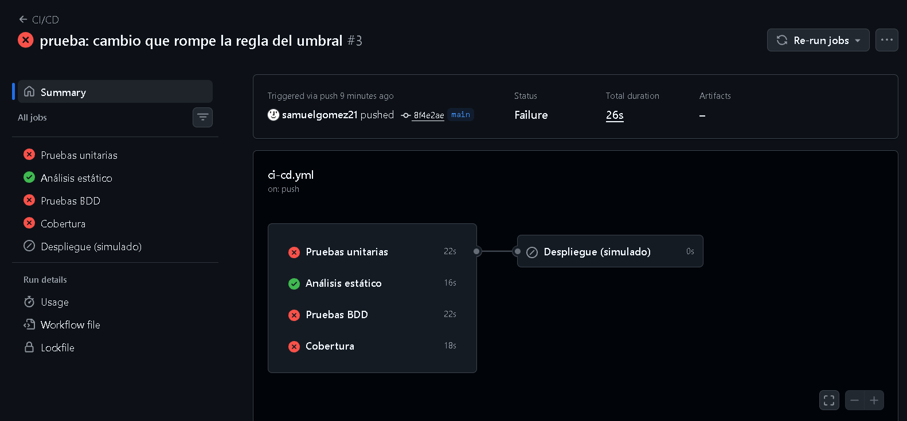
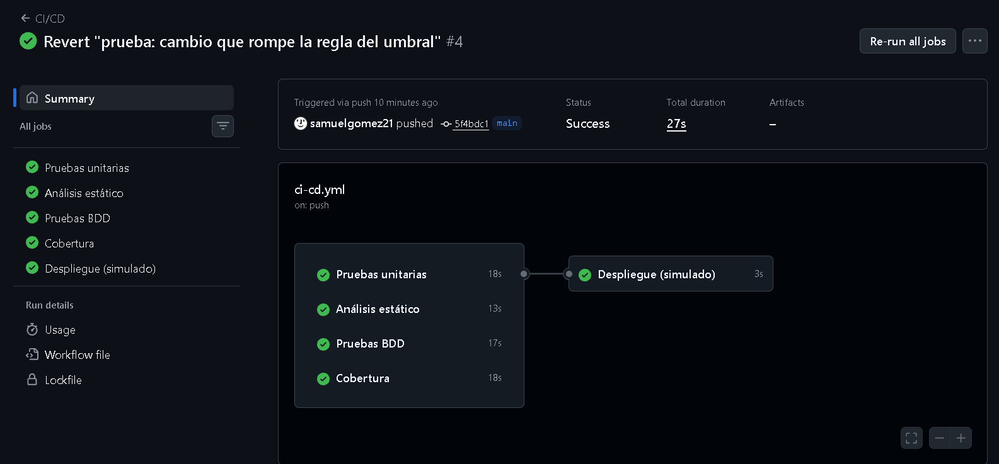
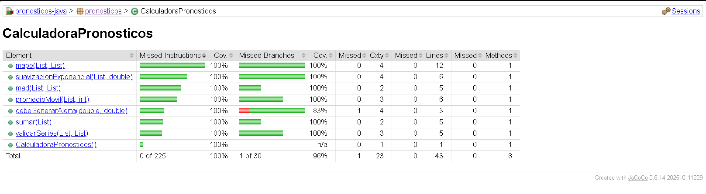

# Informe de la actividad

## Repositorio

[Repositorio de GitHub](https://github.com/samuelgomez21/pronosticos-java-GomezSamuel)

## Evidencias del pipeline y de cobertura

### Pipeline en rojo

En esta ejecución cambié temporalmente la comparación de `>=` por `>`. Por eso fallaron las pruebas que revisan el caso donde el error es igual al umbral y el despliegue quedó sin ejecutarse.

### Pipeline en verde

Después hice el revert del cambio anterior. Con la regla correcta, los cuatro trabajos de verificación pasaron y el despliegue simulado se ejecutó.

### Reporte de JaCoCo

El reporte se generó con `mvn verify`. La cobertura de líneas quedó en 100 % y la de ramas en más de 90 %, por lo que la verificación configurada en JaCoCo pasó correctamente.

## Respuestas

### ¿Qué vi en el rojo del Paso 2.1 y por qué en Java suele ser un error de compilación?

Vi un error `cannot find symbol` porque la prueba intentaba usar `suavizacionExponencial`, pero ese método todavía no existía en la clase. En Java primero se compila todo antes de ejecutar las pruebas, entonces si se llama a un método que no está creado, el programa ni siquiera puede empezar a correr. Por eso el rojo en este caso fue de compilación y no una prueba fallida normal.

### ¿Por qué el MAPE del caso `[80, 0, 95]` se divide entre 2?

Se divide entre 2 porque el período donde la demanda real es 0 no se puede usar para sacar el porcentaje: tocaría dividir entre cero. Ese período se excluye y solo quedan los valores de 80 y 95, que son los dos períodos válidos para hacer el promedio.

### ¿Por qué las pruebas unitarias crean la calculadora con `new` en lugar de levantar Spring?

La calculadora tiene las reglas de negocio y no depende de Spring, de una base de datos ni de servicios externos. Al crearla con `new` la prueba se concentra solo en el método que se quiere revisar, corre más rápido y no depende de que toda la aplicación esté levantada.

### ¿Qué diferencia hay entre una prueba unitaria y un escenario BDD en este proyecto?

La prueba unitaria revisa directamente un método pequeño de Java, por ejemplo si `debeGenerarAlerta` devuelve verdadero o falso. El escenario BDD describe la misma regla de negocio con palabras más fáciles de leer, usando Dado, Cuando y Entonces. Cucumber conecta esas frases con los pasos en Java para poder ejecutarlas como prueba.

### En el Paso 7.5, ¿qué pruebas fallaron y por qué el despliegue no corrió?

Al cambiar `>=` por `>`, fallaron las pruebas unitarias y los escenarios BDD que revisan que un error igual al umbral también debe generar una alerta. El trabajo de cobertura también falló porque ejecuta todas las pruebas durante `mvn verify`. El despliegue no corrió porque depende de que análisis estático, pruebas unitarias, BDD y cobertura terminen bien; como varias fallaron, GitHub Actions lo omitió.
